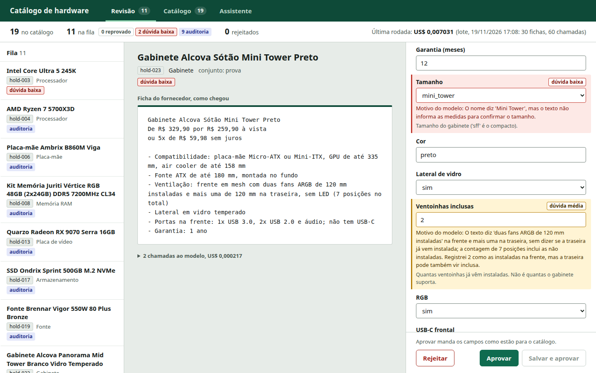
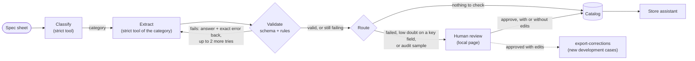
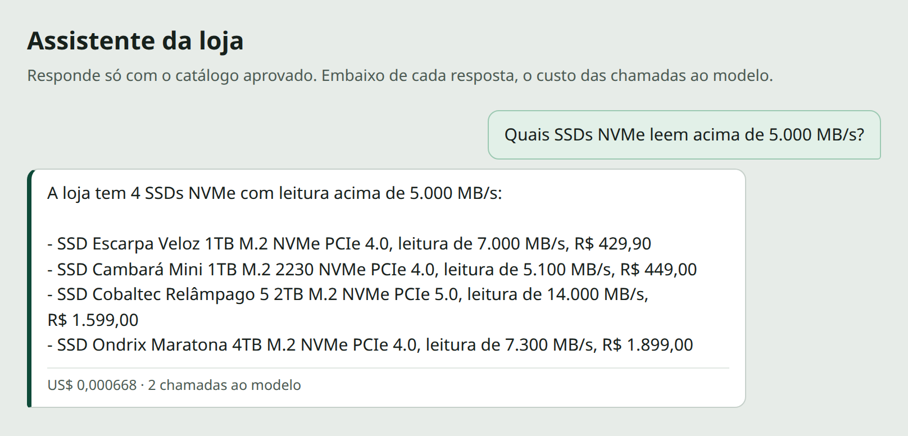
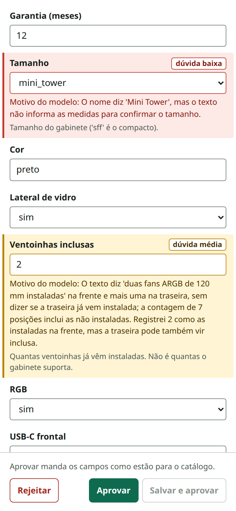

# Hardware catalog pipeline

[Leia em português](README.pt-BR.md)

Messy supplier spec sheets for PC parts go in, a validated store catalog comes out.

Each sheet is classified, then extracted with a strict tool built for its category, then checked by code: a schema and value rules per category. When a check fails, the model gets its answer back with the exact error and tries again. Products that need a second look go to a human review queue on a local page, and the rest go to the catalog. A store assistant answers questions using only the approved catalog.

Built in Python with the [Anthropic SDK](https://github.com/anthropics/anthropic-sdk-python) and Claude Haiku 5.5, plus FastAPI and SQLite. The sheets, the field names, the prompts and the page are in Brazilian Portuguese, with prices in reais.



## The problem

Every supplier writes a spec sheet its own way: a table pasted from a PDF, an e-mail, an ad in caps with emoji, a page in English. The hard part is the numbers that look like a field but mean something else: the power supply recommended for the whole PC next to the card's own power draw, the TDP a cooler can handle, a power supply's peak, a price in installments or in US dollars.

One of the held-out sheets, as it came in:

```text
Placa de Vídeo Tangará GeForce RTX 5060 Broto 8GB GDDR7
de R$ 2.399,00 por apenas R$ 1.999,90 no PIX ou boleto
(ou R$ 2.199,90 em até 10x sem juros)

• Boost de 2497 MHz
• 8 GB GDDR7, 128 bits
• Potência da placa: 145 W | PSU sugerida: 550 W
• Dual fan, 21,5 cm de comprimento, ocupa 2 slots
• Alimentação por um cabo de 8 pinos
• Garantia: 2 anos
```

What the model returned in the held-out batch run, unchanged. First the classification:

```json
{"categoria": "placa_de_video", "categoria_detalhe": null}
```

Then the extraction, with the tool for graphics cards:

```json
{
  "nome": "Placa de Vídeo Tangará GeForce RTX 5060 Broto 8GB GDDR7",
  "marca": "Tangará",
  "preco": 1999.9,
  "garantia_meses": 24,
  "chip": "RTX 5060",
  "fabricante_chip": "nvidia",
  "vram_gb": 8,
  "tipo_vram": "gddr7",
  "clock_boost_mhz": 2497,
  "consumo_w": 145,
  "fonte_recomendada_w": 550,
  "comprimento_mm": 215,
  "duvidas": []
}
```

The price is the cash price, not the list price or the installment total. The power draw is 145 W, not the 550 W power supply. 21.5 cm became 215 mm.

## How it works



- **Classify:** one call with a forced, strict tool returns the category. There are 9: processor, motherboard, RAM, graphics card, storage, power supply, case, cooler, and `outro` with a short description.
- **Extract:** a second forced, strict tool, built for that category, with 7 to 12 fields and `duvidas`: a short list of the fields the model is unsure about, each with a level (`media` or `baixa`) and a reason.
- **Validate:** Pydantic checks the format, then per-category rules check the values. The rules cover plausible ranges (a 1700 W TDP means a wrong unit or a number from another line), consistency (boost ≥ base clock, power draw below the recommended power supply) and a price filled in on a sheet that only shows US dollars. Each error is a sentence in Portuguese that names the field.
- **Correct:** when validation fails, the conversation goes on with the model's answer as a `tool_use` and the exact errors in a `tool_result` with `is_error`, up to 2 more tries. A cut-off answer (`max_tokens`) is sent again with a higher limit. The classification goes through the same loop.
- **Route:** a product goes to the review queue when it still fails after the retries, when the model marked a low (`baixa`) doubt on a key field (price, TDP, power draw, wattage, length...) or when it falls in the audit sample. Everything else goes to the catalog.
- **Review:** on the local page, a person approves, edits and approves, or rejects. Every decision is saved with the values before and after.
- **Assistant:** a tool loop with `buscar_produtos` (text, category, max price, field filters) and `ver_produto`. It only sees approved products, and prices are formatted by code.

There are two modes with the same flow. `--direto` makes one call at a time. `--lote` sends rounds through the Message Batches API, at half the token price. Batch results come back in any order and are matched by `custom_id`. Failed requests are sent again: a technical error as it was, a cut-off answer with more tokens, a validation error with the correction conversation. The batch id is saved in the database, so if the process stops, running it again waits for the pending batch instead of sending a new one.

Every call is saved in SQLite with its tokens, cost, answer and error, and its cost is printed right after it.

### Design decisions

- **Two steps: classify, then extract.** Each category has its own fields. A single tool with every field would go over the strict mode limit of 16 union-typed parameters per request, because every nullable field counts. With one tool per category, the largest one has 11.
- **Every field is required and accepts null.** The model can say "not in the sheet" instead of making up a value. Strict mode also writes required fields before optional ones. With every field required, the answer keeps the schema order, so the doubts, defined last, come after the values they are about.
- **Doubts are a short list, and only a low doubt on a key field sends a product to review.** A score on every field would cost more output tokens. In an earlier test with a confidence score on every field, "high" was always right, but "low" didn't point at the errors. So a medium doubt is only highlighted on the page.
- **A stratified audit sample.** 10% of the products approved automatically go to review anyway, at least 1 per category, with a fixed seed. It catches errors that nothing flagged.
- **A separate held-out set.** The prompts were tuned on 53 development sheets. The 30 held-out sheets were written before any prompt existed, were never used for tuning and were measured once. The numbers below come only from them. The rule is in [data/holdout/README.md](data/holdout/README.md).
- **A fake API built from the answer keys.** `pipeline/fake_client.py` is a real `anthropic.Anthropic` client over a mock transport. It answers the classification, the extraction, the batches and the assistant from the answer keys, and it can inject wrong values, cut-off answers, `errored` and `expired` batch results and results out of order. The tests and the page run with no key and no cost.

## The local page

`cli.py serve` runs a local page at `http://127.0.0.1:8000` with three tabs:

- **Revisão:** the queue with a tag for each reason, the sheet as it came in, the model calls with their cost, and the form. Medium doubts are yellow and low doubts are red, with the model's reason. A validation error shows on the field itself. The buttons are Aprovar, Salvar e aprovar (with edits) and Rejeitar. Approving checks the final values with the same schema and rules.
- **Catálogo:** the approved products, with a filter.
- **Assistente:** the store chat. The cost and the number of model calls show under each answer.

The top bar shows the catalog, the queue by reason, the rejected products and the cost of the last run. The server only listens on your machine, checks the Host header and only accepts JSON in POST requests.

| The assistant, with a real answer | Review on a phone |
|---|---|
|  |  |

## Results

Measured on the 30 held-out sheets, once, with the prompt frozen. The full tables (per field, per style, every error) are in [docs/results.md](docs/results.md), in Portuguese.

| Mode | Fields right | Category right | Sheets with no error |
|---|---|---|---|
| Batch | 297 of 300 (99.0%) | 30 of 30 | 28 of 30 (93.3%) |
| Direct | 297 of 300 (99.0%) | 30 of 30 | 28 of 30 (93.3%) |

`nome` is left out, because every store writes it its own way. The two free-text descriptions (`categoria_detalhe` and `conexao`) are listed apart. Numbers, true/false and options must match the answer key exactly. Other text ignores case and accents.

**By field and category.** 52 of the 55 fields were right on every sheet. The 3 errors were on 2 sheets, the same in both modes:

| Sheet | Field | Answer key | Extracted | Doubt |
|---|---|---|---|---|
| hold-019 (power supply) | `preco` | 299.4 | 298.8 | none |
| hold-019 (power supply) | `modularidade` | `nao_modular` | `modular` | none |
| hold-023 (case) | `ventoinhas_inclusas` | 3 | 2 | medium |

Power supplies got 28 of 30 fields and cases 26 of 27. The other 7 categories got every field right.

**Calibration:** how often a field is right, by the doubt the model marked on it (batch run).

| Doubt | Fields right |
|---|---|
| none | 293 of 295 (99.3%) |
| medium | 2 of 3 |
| low | 2 of 2 |

**The queue (batch run).** Of the 2 sheets with errors, the queue caught hold-023, by chance, through a low doubt on another field. The audit sample caught hold-019. None reached the catalog. There was 1 false alarm: a low doubt on a price that was correctly left empty, because the sheet only had dollars. The audit also sent 8 correct sheets to review. In the direct run, hold-023 went straight to the catalog.

**Cost per sheet,** with classification, extraction and corrections:

| Mode | Calls | Total | Per sheet |
|---|---|---|---|
| Batch | 60 | US$ 0.007031 | US$ 0.000234 |
| Direct | 60 | US$ 0.010477 | US$ 0.000349 |

Batch tokens cost half, but this batch run came to 67% of the direct one, because of the prompt cache. The direct run started right after the last development run, with the same prompt, so it only read the cache, at 0.1× the input price. The batch run wrote the cache again: 32,151 tokens at 1.25×, US$ 0.0020, 29% of its cost. With the same cache, the batch would cost US$ 0.000173 per sheet, 49% of the direct run.

**Development set.** On the 50 development sheets that are not prompt examples, the first prompt got 488 of 492 fields right, and two rounds of prompt changes brought it to 492 of 492. That number is optimistic by design: [docs/results-dev.md](docs/results-dev.md).

**The assistant:** 3 real questions ("the cheapest 12 GB graphics card", "an 850 W modular power supply", "NVMe SSDs that read above 5,000 MB/s"), with the right answer checked in SQL first. All 3 answers matched the catalog, with no invented product or price, at US$ 0.0003 to 0.0007 per question. The first try at the third one used "at least" and also listed an SSD at exactly 5,000 MB/s, so the search got strict `acima` and `abaixo` filters.

Every real API call made to build and measure v1 (development tests, tuning, the two held-out runs and the assistant questions) cost about US$ 0.11 in total.

## Run it

You need Python 3.12. The tests, the fake pipeline and the page run without an API key.

```bash
git clone https://github.com/petrecaLeo/hardware-catalog-pipeline.git
cd hardware-catalog-pipeline
python3.12 -m venv .venv
.venv/bin/pip install -r requirements-dev.txt
.venv/bin/pytest            # 259 tests, no key and no network
```

### Without a key: the fake API

```bash
.venv/bin/python cli.py ingest data/dev/fichas.jsonl data/holdout/fichas.jsonl   # 83 new sheets
.venv/bin/python cli.py process --direto --fake    # or --lote --fake
.venv/bin/python cli.py status
.venv/bin/python cli.py serve --fake               # http://127.0.0.1:8000, Ctrl-C to stop
```

- The fake API answers from the answer keys, so every value comes out right. To give the queue something to show, `--fake` simulates three problems. dev-030 comes back with a wrong warranty that the correction never fixes (failed). dev-005 has a low doubt on `tdp_w`. dev-019 has a low doubt on `consumo_w` and a medium one on `comprimento_mm`. With the 83 sheets, 71 go to the catalog and 12 to the queue: 1 failed, 2 low doubts and 9 from the audit sample.
- The tokens and costs it prints, and the cost on the page, are simulated from the size of each request and answer. Nothing is billed.
- A sheet the fake API doesn't know (anything outside `data/dev` and `data/holdout`) comes back as `outro`, "produto não identificado".
- With `serve --fake`, the assistant doesn't read the question: it always answers with the number of products in the catalog and the cheapest one. Without `--fake` and without a key, the chat answers 503 and says what to do. The review and the catalog work either way.
- A fake batch lives in memory. If you stop a `process --lote --fake` and run it again, the old batch is gone, so the same requests go out in a new one.

### With a key: the real API, billed to you

```bash
cp .env.example .env       # then put your ANTHROPIC_API_KEY in .env
.venv/bin/python cli.py --db data/real.db ingest data/dev/fichas.jsonl data/holdout/fichas.jsonl
.venv/bin/python cli.py --db data/real.db process --lote --conjunto holdout   # about US$ 0.007
.venv/bin/python cli.py --db data/real.db eval --conjunto holdout
.venv/bin/python cli.py --db data/real.db serve
```

`--db` goes before the command, and a new database keeps the real run apart from the fake one. Without it, everything goes to `data/catalog.db`. The 83 sheets cost about US$ 0.02 in batch. A batch can take a few minutes or more. If you stop it, run the same `process --lote` again to resume. Each real assistant question cost less than US$ 0.001 in the tests.

### All commands

- `ingest <file.jsonl | folder of .txt>`: saves the sheets without duplicates (the text hash identifies a sheet). `data/dev` and `data/holdout` keep their set. Anything else, like a folder of your own `.txt` sheets, goes to `inbox`.
- `process --direto | --lote [--conjunto dev|holdout|inbox] [--limite N] [--fake]`: extracts and validates the pending sheets, then routes them.
- `route`: routes products that have no destination yet. `process` already does it at the end. This is for a batch run stopped with Ctrl-C.
- `status`: pending sheets, the runs with their cost, and the products by category and destination.
- `eval --conjunto dev|holdout [--comparar OTHER.db] [--salvar]`: compares the products with the answer keys. `--salvar` writes `docs/results.md` (held-out) or `docs/results-dev.md` (development) and keeps the handwritten notes at the end of the file.
- `export-corrections [--saida FILE]`: turns each product that was approved with edits into a sheet with an answer key, in `data/corrections.jsonl`, in the format of `data/dev/fichas.jsonl`. There are two kinds of lines:
  - a new sheet (from the inbox) comes out as `corr-<hash>`. It is a new case, ready to append to `data/dev/fichas.jsonl`;
  - a sheet the development set already has comes out with its own id, like `dev-030`. It is not a new case: it is there to compare with the answer key.

  Held-out sheets are left out, even a copy that came in through the inbox. A correction that fails the rules against the sheet text is skipped, with the reason. A new development case changes the fixed numbers in 6 tests that check exact output (sheet counts, audit sample, accuracy), so update them with the case.
- `serve [--fake]`: the page on `127.0.0.1:8000`.

The tests use the fake API: `tests/conftest.py` sets a fake key before anything is imported, so they never call the real one.

## Project layout

```
cli.py               commands: ingest, process, route, status, eval, export-corrections, serve
pipeline/
  config.py          model, prices (direct, batch, cache), limits, paths
  schemas.py         Pydantic models per category: the one place the fields are defined
  tools.py           strict tool definitions, generated from the models
  prompts/           classification, extraction and assistant prompts (Portuguese)
  rules.py           value rules per category, with the error messages
  extract.py         classify, extract, validate and correct, one call at a time
  batch.py           the same flow with the Message Batches API: custom_id, resend, resume
  route.py           catalog or review queue, stratified audit sample
  db.py              SQLite: sheets, runs, attempts, products, reviews, batches
  evaluate.py        accuracy per field, calibration, queue quality, cost per mode
  assistant.py       store assistant: a tool loop over the approved catalog
  fake_client.py     fake Anthropic API built from the answer keys
  sheets.py          loads the sheet files and answer keys
api/main.py          FastAPI: review, catalog, summary and chat, on 127.0.0.1 only
web/                 the page (HTML, CSS and JavaScript, no build step)
data/dev/            53 development sheets with answer keys, used for tuning
data/holdout/        30 held-out sheets with answer keys, only for measuring
docs/                results and screenshots
tests/               259 tests with the fake API
```

## Limitations

- **The sheets are invented and written by one person,** the same person who wrote the answer keys and the prompts. The brands are made up, and the chips and their numbers are real. Real supplier sheets will be messy in ways this set doesn't cover.
- **The held-out set is small.** With 30 sheets, one error moves field accuracy by 0.3 points and "sheets with no error" by 3.3 points.
- **The model does the installment math.** hold-019 only shows "6x de R$ 49,90", and the model wrote 298.80 instead of 299.40. Extracting the number and the value of the installments and multiplying in code would be safer.
- **A valid value with the wrong meaning passes.** "Todos os cabos presos à fonte" (every cable attached to the power supply) became `modular`, with no doubt. No rule catches a value that is valid but wrong, and `modularidade` isn't a key field, so only the audit sample caught it.
- **The doubts warn little.** None of the 3 errors had a low doubt, and every low doubt was on a correct field. The miscounted fans in hold-023 had a medium doubt, which doesn't fill the queue: in the batch run, the sheet reached review through a low doubt on another field, and in the direct run it went to the catalog.
- **The correction loop only fixes what a rule detects.** On the held-out set every answer passed validation on the first try, so the loop never ran there.
- **The category can't be changed in review.** A product in the wrong category has to be rejected. On the held-out set, the category was right on all 30 sheets.
- **The assistant was checked on 3 real questions only.**
- **A stop at the wrong moment can send a batch twice.** If the process stops between sending a batch and saving its id, the next run doesn't know about it and sends a new one.

## Next steps

v2 is about part compatibility. The sheets already carry socket, memory type, the motherboard's CPU power limit, the case clearances and the cooler's supported TDP. The next version extracts them and checks a build in code (does the card fit the case? can the power supply handle it?), in a "Monte seu PC" tab and in the assistant.
