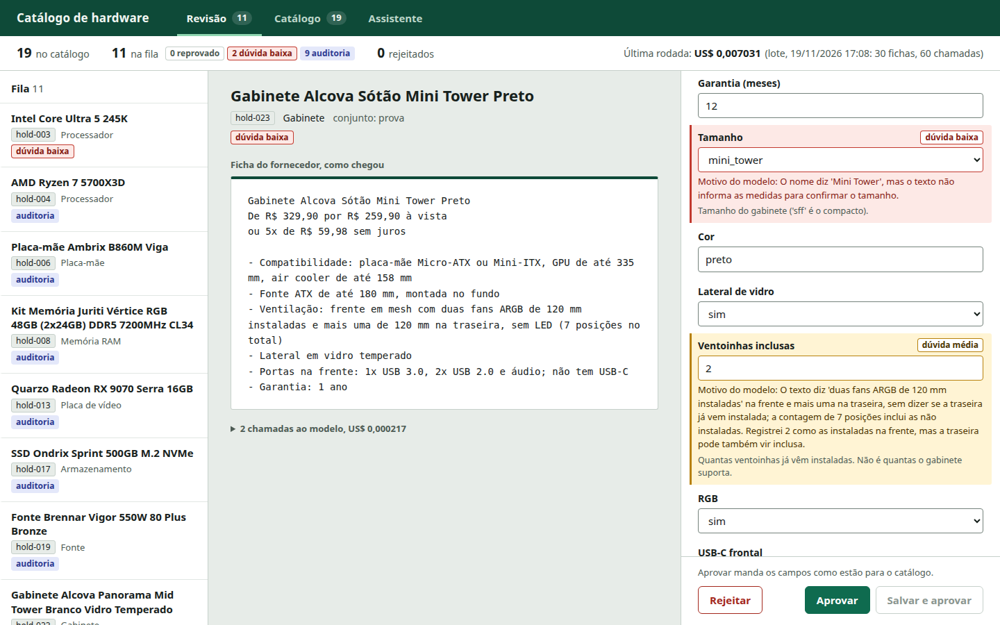
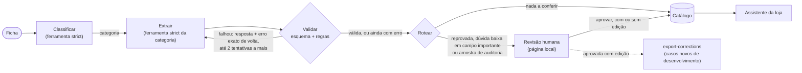
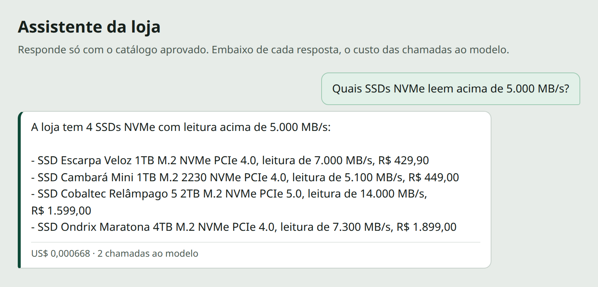
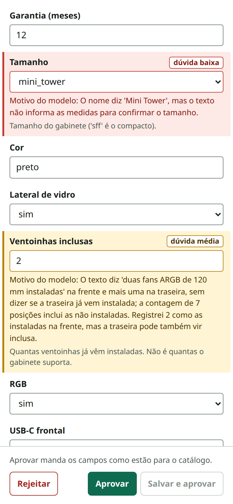

# Hardware catalog pipeline

[Read in English](README.md)

Fichas técnicas bagunçadas de fornecedores de peças de computador entram, e um catálogo de loja validado sai.

Cada ficha é classificada, depois extraída com uma ferramenta strict feita para a categoria dela, e depois conferida pelo código: um esquema e regras de valor por categoria. Quando algo falha, o modelo recebe a própria resposta de volta com o erro exato e tenta de novo. Os produtos que precisam de um segundo olhar vão para uma fila de revisão humana numa página local, e o resto vai para o catálogo. Um assistente da loja responde às perguntas usando só o catálogo aprovado.

Feito em Python com o [SDK da Anthropic](https://github.com/anthropics/anthropic-sdk-python) e o Claude Haiku 5.5, mais FastAPI e SQLite. As fichas, os nomes dos campos, os prompts e a página estão em português, com preço em reais.



## O problema

Cada fornecedor escreve a ficha de um jeito: tabela colada de PDF, e-mail, anúncio em caixa alta com emoji, página em inglês. O difícil são os números que parecem ser de um campo, mas são de outra coisa: a fonte recomendada para o PC inteiro ao lado do consumo da própria placa, o TDP que um cooler aguenta, o pico de uma fonte, o preço parcelado ou em dólar.

Uma das fichas da prova, como chegou:

```text
Placa de Vídeo Tangará GeForce RTX 5060 Broto 8GB GDDR7
de R$ 2.399,00 por apenas R$ 1.999,90 no PIX ou boleto
(ou R$ 2.199,90 em até 10x sem juros)

• Boost de 2497 MHz
• 8 GB GDDR7, 128 bits
• Potência da placa: 145 W | PSU sugerida: 550 W
• Dual fan, 21,5 cm de comprimento, ocupa 2 slots
• Alimentação por um cabo de 8 pinos
• Garantia: 2 anos
```

O que o modelo devolveu na rodada em lote da prova, sem mudar nada. Primeiro a classificação:

```json
{"categoria": "placa_de_video", "categoria_detalhe": null}
```

Depois a extração, com a ferramenta das placas de vídeo:

```json
{
  "nome": "Placa de Vídeo Tangará GeForce RTX 5060 Broto 8GB GDDR7",
  "marca": "Tangará",
  "preco": 1999.9,
  "garantia_meses": 24,
  "chip": "RTX 5060",
  "fabricante_chip": "nvidia",
  "vram_gb": 8,
  "tipo_vram": "gddr7",
  "clock_boost_mhz": 2497,
  "consumo_w": 145,
  "fonte_recomendada_w": 550,
  "comprimento_mm": 215,
  "duvidas": []
}
```

O preço é o à vista, e não o "de" nem o total parcelado. O consumo é 145 W, e não a fonte de 550 W. 21,5 cm viraram 215 mm.

## Como funciona



- **Classificar:** uma chamada com uma ferramenta forçada e strict devolve a categoria. São 9: processador, placa-mãe, memória RAM, placa de vídeo, armazenamento, fonte, gabinete, cooler e `outro`, com uma descrição curta.
- **Extrair:** uma segunda ferramenta forçada e strict, feita para a categoria, com 7 a 12 campos e `duvidas`: uma lista curta dos campos em que o modelo não tem certeza, cada um com um nível (`media` ou `baixa`) e um motivo.
- **Validar:** o Pydantic confere o formato, e depois as regras da categoria conferem os valores. As regras cobrem faixas plausíveis (um TDP de 1700 W é unidade errada ou número de outra linha), coerência (boost ≥ clock base, consumo abaixo da fonte recomendada) e preço preenchido numa ficha que só mostra dólar. Cada erro é uma frase em português que diz o campo.
- **Corrigir:** quando a validação falha, a conversa continua com a resposta do modelo num `tool_use` e os erros exatos num `tool_result` com `is_error`, até 2 tentativas a mais. Uma resposta cortada (`max_tokens`) vai de novo com um limite maior. A classificação passa pelo mesmo laço.
- **Rotear:** o produto vai para a fila de revisão quando continua com erro depois das tentativas, quando o modelo marcou dúvida baixa num campo importante (preço, TDP, consumo, potência, comprimento...) ou quando cai na amostra de auditoria. O resto vai para o catálogo.
- **Revisar:** na página local, uma pessoa aprova, edita e aprova, ou rejeita. Cada decisão fica salva com os valores de antes e de depois.
- **Assistente:** um laço de ferramentas com `buscar_produtos` (texto, categoria, preço máximo, filtros por campo) e `ver_produto`. Ele só enxerga os produtos aprovados, e o preço é formatado pelo código.

São dois modos com o mesmo fluxo. O `--direto` faz uma chamada por vez. O `--lote` manda rodadas pela API de lotes (Message Batches), pela metade do preço dos tokens. Os resultados do lote voltam fora de ordem e são casados pelo `custom_id`. Os pedidos que falham vão de novo: erro técnico vai igual, resposta cortada vai com mais tokens, erro de validação vai com a conversa de correção. O id do lote fica salvo no banco: se o processo parar, rodar de novo espera o lote pendente em vez de mandar outro.

Cada chamada fica salva no SQLite com os tokens, o custo, a resposta e o erro, e o custo dela sai impresso logo depois.

### Decisões

- **Duas etapas: classificar e depois extrair.** Cada categoria tem os seus campos. Uma ferramenta só, com todos os campos, passaria do limite do modo strict de 16 parâmetros com união por pedido, porque todo campo que aceita null conta. Com uma ferramenta por categoria, a maior tem 11.
- **Todo campo é obrigatório e aceita null.** O modelo pode dizer "não está na ficha" em vez de inventar um valor. O modo strict também escreve os campos obrigatórios antes dos opcionais. Com todos obrigatórios, a resposta segue a ordem do esquema, e as dúvidas, que vêm por último nele, saem depois dos valores de que elas falam.
- **As dúvidas vêm numa lista curta, e só a dúvida baixa num campo importante manda o produto para a revisão.** Uma nota para cada campo gastaria mais tokens de saída. Num teste anterior, com nota de confiança em todos os campos, a nota "alta" sempre acertou, mas a "baixa" não apontou os erros. Por isso a dúvida média só fica destacada na tela.
- **Amostra de auditoria estratificada.** 10% dos produtos aprovados automaticamente vão para a revisão mesmo assim, no mínimo 1 por categoria, com semente fixa. Ela pega erros que nada sinalizou.
- **Um conjunto de prova separado.** Os prompts foram ajustados em 53 fichas de desenvolvimento. As 30 fichas de prova foram escritas antes de existir qualquer prompt, nunca foram usadas para ajustar nada e foram medidas uma vez. Os números abaixo vêm só delas. A regra está em [data/holdout/README.md](data/holdout/README.md).
- **Uma API falsa montada a partir dos gabaritos.** O `pipeline/fake_client.py` é um cliente `anthropic.Anthropic` de verdade sobre um transporte falso. Ele responde à classificação, à extração, aos lotes e ao assistente a partir dos gabaritos, e consegue injetar valor errado, resposta cortada, resultado `errored` e `expired` no lote e resultados fora de ordem. Os testes e a página rodam sem chave e sem custo.

## A página local

O `cli.py serve` sobe uma página local em `http://127.0.0.1:8000` com três abas:

- **Revisão:** a fila com uma etiqueta para cada motivo, a ficha como chegou, as chamadas ao modelo com o custo, e o formulário. A dúvida média fica em amarelo e a baixa em vermelho, com o motivo do modelo. O erro de validação aparece no próprio campo. Os botões são Aprovar, Salvar e aprovar (com edição) e Rejeitar. Aprovar confere os valores finais com o mesmo esquema e as mesmas regras.
- **Catálogo:** os produtos aprovados, com um filtro.
- **Assistente:** o chat da loja. O custo e o número de chamadas ao modelo aparecem embaixo de cada resposta.

O topo mostra o catálogo, a fila por motivo, os rejeitados e o custo da última rodada. O servidor só escuta na sua máquina, confere o cabeçalho Host e só aceita JSON nos POST.

| O assistente, com uma resposta real | A revisão no celular |
|---|---|
|  |  |

## Resultados

Medidos nas 30 fichas de prova, uma vez, com o prompt congelado. As tabelas completas (por campo, por estilo, cada erro) estão em [docs/results.md](docs/results.md).

| Modo | Campos certos | Categoria certa | Fichas sem erro |
|---|---|---|---|
| Lote | 297 de 300 (99,0%) | 30 de 30 | 28 de 30 (93,3%) |
| Direto | 297 de 300 (99,0%) | 30 de 30 | 28 de 30 (93,3%) |

O `nome` fica de fora, porque cada loja escreve de um jeito. As duas descrições livres (`categoria_detalhe` e `conexao`) aparecem à parte. Números, verdadeiro/falso e opções têm que ser iguais ao gabarito. Os outros textos são comparados sem diferença de caixa e acento.

**Por campo e categoria.** 52 dos 55 campos acertaram em todas as fichas. Os 3 erros foram em 2 fichas, os mesmos nos dois modos:

| Ficha | Campo | Gabarito | Extraído | Dúvida |
|---|---|---|---|---|
| hold-019 (fonte) | `preco` | 299.4 | 298.8 | nenhuma |
| hold-019 (fonte) | `modularidade` | `nao_modular` | `modular` | nenhuma |
| hold-023 (gabinete) | `ventoinhas_inclusas` | 3 | 2 | média |

As fontes tiveram 28 de 30 campos certos, e os gabinetes 26 de 27. As outras 7 categorias acertaram todos os campos.

**Calibração:** quantos campos estavam certos, conforme a dúvida que o modelo marcou neles (rodada em lote).

| Dúvida | Campos certos |
|---|---|
| nenhuma | 293 de 295 (99,3%) |
| média | 2 de 3 |
| baixa | 2 de 2 |

**A fila (rodada em lote).** Das 2 fichas com erro, a fila pegou a hold-023, por acaso, por uma dúvida baixa em outro campo. A amostra de auditoria pegou a hold-019. Nenhuma chegou ao catálogo. Houve 1 alarme falso: uma dúvida baixa num preço que ficou vazio do jeito certo, porque a ficha só tinha dólar. A auditoria também mandou 8 fichas certas para a revisão. Na rodada direta, a hold-023 foi direto para o catálogo.

**Custo por ficha,** com classificação, extração e correções:

| Modo | Chamadas | Total | Por ficha |
|---|---|---|---|
| Lote | 60 | US$ 0,007031 | US$ 0,000234 |
| Direto | 60 | US$ 0,010477 | US$ 0,000349 |

O token no lote custa a metade, mas esta rodada em lote saiu a 67% da direta, por causa do cache do prompt. A rodada direta começou logo depois da última rodada de desenvolvimento, com o mesmo prompt, então só leu o cache, a 0,1× o preço de entrada. A rodada em lote gravou o cache de novo: 32.151 tokens a 1,25×, US$ 0,0020, 29% do custo dela. Com o mesmo cache, o lote sairia a US$ 0,000173 por ficha, 49% da rodada direta.

**Conjunto de desenvolvimento.** Nas 50 fichas de desenvolvimento que não são exemplo do prompt, o primeiro prompt acertou 488 de 492 campos, e duas rodadas de ajuste no prompt levaram a 492 de 492. Esse número é otimista por construção: [docs/results-dev.md](docs/results-dev.md).

**O assistente:** 3 perguntas reais ("a placa de vídeo mais barata com 12 GB", "uma fonte de 850 W modular", "SSDs NVMe que leem acima de 5.000 MB/s"), com a resposta certa conferida antes por SQL. As 3 respostas bateram com o catálogo, sem produto nem preço inventado, a US$ 0,0003 a 0,0007 por pergunta. Na primeira tentativa da terceira, o modelo usou "no mínimo" e listou também um SSD de exatamente 5.000 MB/s. Por isso a busca ganhou os filtros estritos `acima` e `abaixo`.

Todas as chamadas reais à API feitas para construir e medir a v1 (testes no desenvolvimento, o ajuste, as duas rodadas da prova e as perguntas ao assistente) custaram cerca de US$ 0,11 no total.

## Como rodar

Você precisa do Python 3.12. Os testes, o pipeline com a API falsa e a página rodam sem chave da API.

```bash
git clone https://github.com/petrecaLeo/hardware-catalog-pipeline.git
cd hardware-catalog-pipeline
python3.12 -m venv .venv
.venv/bin/pip install -r requirements-dev.txt
.venv/bin/pytest            # 259 testes, sem chave e sem rede
```

### Sem chave: a API falsa

```bash
.venv/bin/python cli.py ingest data/dev/fichas.jsonl data/holdout/fichas.jsonl   # 83 fichas novas
.venv/bin/python cli.py process --direto --fake    # ou --lote --fake
.venv/bin/python cli.py status
.venv/bin/python cli.py serve --fake               # http://127.0.0.1:8000, Ctrl-C para parar
```

- A API falsa responde a partir dos gabaritos, então todo valor sai certo. Para a fila ter o que mostrar, o `--fake` simula três problemas. A dev-030 volta com uma garantia errada que a correção nunca conserta (reprovada). A dev-005 tem dúvida baixa em `tdp_w`. A dev-019 tem dúvida baixa em `consumo_w` e média em `comprimento_mm`. Com as 83 fichas, 71 vão para o catálogo e 12 para a fila: 1 reprovada, 2 com dúvida baixa e 9 da amostra de auditoria.
- Os tokens e o custo que ela imprime, e o custo que aparece na página, são simulados a partir do tamanho de cada pedido e resposta. Nada é cobrado.
- Uma ficha que a API falsa não conhece (qualquer uma fora de `data/dev` e `data/holdout`) volta como `outro`, "produto não identificado".
- Com o `serve --fake`, o assistente não lê a pergunta: ele sempre responde com o número de produtos do catálogo e o mais barato. Sem `--fake` e sem chave, o chat responde 503 e diz o que fazer. A revisão e o catálogo funcionam do mesmo jeito nos dois casos.
- O lote falso fica na memória. Se você interromper um `process --lote --fake` e rodar de novo, o lote antigo já não existe, e os mesmos pedidos vão num lote novo.

### Com chave: a API real, cobrada na sua conta

```bash
cp .env.example .env       # depois coloque a sua ANTHROPIC_API_KEY no .env
.venv/bin/python cli.py --db data/real.db ingest data/dev/fichas.jsonl data/holdout/fichas.jsonl
.venv/bin/python cli.py --db data/real.db process --lote --conjunto holdout   # cerca de US$ 0,007
.venv/bin/python cli.py --db data/real.db eval --conjunto holdout
.venv/bin/python cli.py --db data/real.db serve
```

O `--db` vem antes do comando, e um banco novo separa a rodada real da falsa. Sem ele, tudo vai para o `data/catalog.db`. As 83 fichas custam cerca de US$ 0,02 em lote. Um lote pode levar alguns minutos ou mais. Se você interromper, rode o mesmo `process --lote` de novo para retomar. Nos testes, cada pergunta real ao assistente custou menos de US$ 0,001.

### Todos os comandos

- `ingest <arquivo.jsonl | pasta de .txt>`: guarda as fichas sem repetir (o hash do texto identifica a ficha). As de `data/dev` e `data/holdout` ficam no conjunto delas. Todo o resto, como uma pasta com as suas próprias fichas em `.txt`, vai para `inbox`.
- `process --direto | --lote [--conjunto dev|holdout|inbox] [--limite N] [--fake]`: extrai e valida as fichas pendentes e depois roteia.
- `route`: roteia os produtos que ainda não têm destino. O `process` já faz isso no fim. Serve para uma rodada em lote interrompida com Ctrl-C.
- `status`: fichas pendentes, as rodadas com o custo, e os produtos por categoria e destino.
- `eval --conjunto dev|holdout [--comparar OUTRO.db] [--salvar]`: compara os produtos com os gabaritos. O `--salvar` grava `docs/results.md` (prova) ou `docs/results-dev.md` (desenvolvimento) e mantém as notas escritas à mão no fim do arquivo.
- `export-corrections [--saida ARQUIVO]`: cada produto aprovado com edição vira uma ficha com gabarito em `data/corrections.jsonl`, no formato do `data/dev/fichas.jsonl`. Há dois tipos de linha:
  - uma ficha nova (da inbox) sai como `corr-<hash>`. É um caso novo, pronto para colar no fim do `data/dev/fichas.jsonl`;
  - uma ficha que o desenvolvimento já tem sai com o id dela, como `dev-030`. Não é caso novo: serve para comparar com o gabarito.

  As fichas da prova ficam de fora, até uma cópia que entrou pela inbox. Uma correção que não passa nas regras com o texto da ficha é pulada, com o motivo. Um caso novo no desenvolvimento muda os números fixos de 6 testes que conferem a saída exata (contagem de fichas, amostra de auditoria, acerto): atualize esses números junto com o caso.
- `serve [--fake]`: a página em `127.0.0.1:8000`.

Os testes usam a API falsa: o `tests/conftest.py` define uma chave falsa antes de qualquer import, então eles nunca chamam a API real.

## Estrutura

```
cli.py               comandos: ingest, process, route, status, eval, export-corrections, serve
pipeline/
  config.py          modelo, preços (direto, lote, cache), limites, caminhos
  schemas.py         modelos Pydantic por categoria: o único lugar onde os campos são definidos
  tools.py           definições das ferramentas strict, geradas a partir dos modelos
  prompts/           prompts da classificação, da extração e do assistente
  rules.py           regras de valor por categoria, com as mensagens de erro
  extract.py         classificar, extrair, validar e corrigir, uma chamada por vez
  batch.py           o mesmo fluxo com a API de lotes: custom_id, reenvio, retomada
  route.py           catálogo ou fila de revisão, amostra de auditoria estratificada
  db.py              SQLite: fichas, rodadas, tentativas, produtos, revisões, lotes
  evaluate.py        acerto por campo, calibração, qualidade da fila, custo por modo
  assistant.py       assistente da loja: um laço de ferramentas sobre o catálogo aprovado
  fake_client.py     API falsa da Anthropic, montada a partir dos gabaritos
  sheets.py          lê os arquivos de fichas e os gabaritos
api/main.py          FastAPI: revisão, catálogo, resumo e chat, só em 127.0.0.1
web/                 a página (HTML, CSS e JavaScript, sem build)
data/dev/            53 fichas de desenvolvimento com gabarito, usadas no ajuste
data/holdout/        30 fichas de prova com gabarito, só para medir
docs/                resultados e screenshots
tests/               259 testes com a API falsa
```

## Limitações

- **As fichas são inventadas e escritas por uma pessoa só,** a mesma que escreveu os gabaritos e os prompts. As marcas são inventadas, e os chips e os números deles são reais. Fichas reais de fornecedor vão ser bagunçadas de jeitos que este conjunto não cobre.
- **A prova é pequena.** Com 30 fichas, um erro muda o acerto dos campos em 0,3 ponto e as "fichas sem erro" em 3,3 pontos.
- **A conta do parcelado fica com o modelo.** A hold-019 só mostra "6x de R$ 49,90", e o modelo escreveu 298,80 em vez de 299,40. Extrair o número e o valor das parcelas e multiplicar no código seria mais seguro.
- **Um valor válido com o sentido trocado passa.** "Todos os cabos presos à fonte" virou `modular`, sem dúvida. Nenhuma regra pega um valor válido que está errado, e `modularidade` não é campo importante, então só a amostra de auditoria pegou.
- **As dúvidas avisam pouco.** Nenhum dos 3 erros teve dúvida baixa, e toda dúvida baixa caiu em campo certo. As ventoinhas contadas errado na hold-023 tiveram dúvida média, que não manda para a fila: na rodada em lote, a ficha chegou à revisão por uma dúvida baixa em outro campo, e na rodada direta foi para o catálogo.
- **O laço de correção só conserta o que uma regra detecta.** Na prova, toda resposta passou na validação de primeira, então o laço nem rodou lá.
- **A categoria não muda na revisão.** Um produto na categoria errada precisa ser rejeitado. Na prova, a categoria acertou nas 30 fichas.
- **O assistente foi conferido em só 3 perguntas reais.**
- **Uma parada na hora errada pode mandar um lote duas vezes.** Se o processo parar entre o envio do lote e a gravação do id dele, a próxima rodada não sabe do lote e manda outro.

## Próximos passos

A v2 é sobre compatibilidade de peças. As fichas já trazem socket, tipo de memória, o limite de potência de processador da placa-mãe, as medidas internas do gabinete e o TDP suportado pelo cooler. A próxima versão extrai esses dados e confere uma montagem no código (a placa cabe no gabinete? a fonte aguenta?), numa aba "Monte seu PC" e no assistente.
